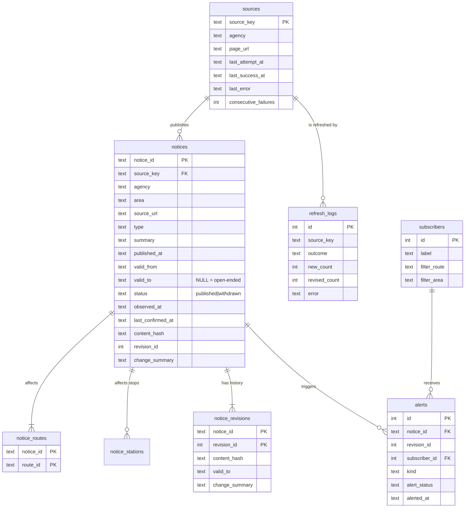

# Database ER diagram (paste into https://mermaid.live to export as an image for the report)

Required fields from the brief map to: `notice_id, agency, route_id (notice_routes), area, source_url, type, summary,
published_at, valid_from, valid_to, status, observed_at, last_confirmed_at, content_hash, revision_id,
change_summary, subscriber_filter (subscribers.filter_*), alert_status, alerted_at (alerts)`.
